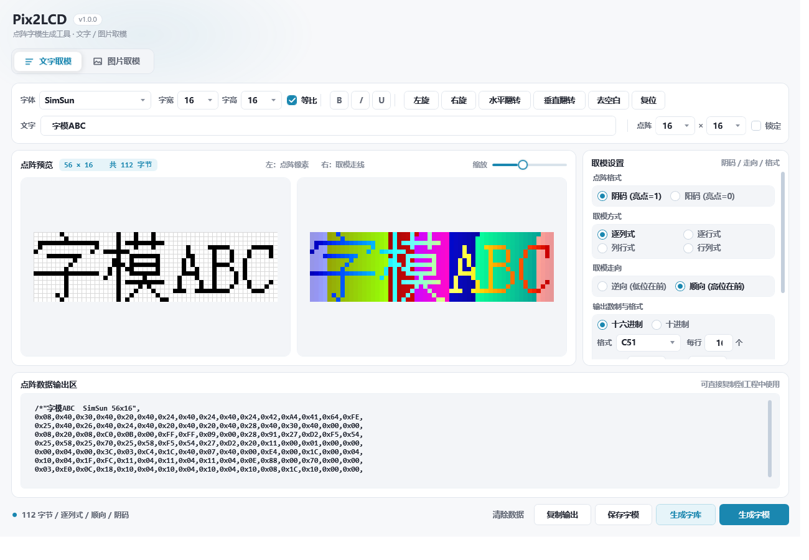
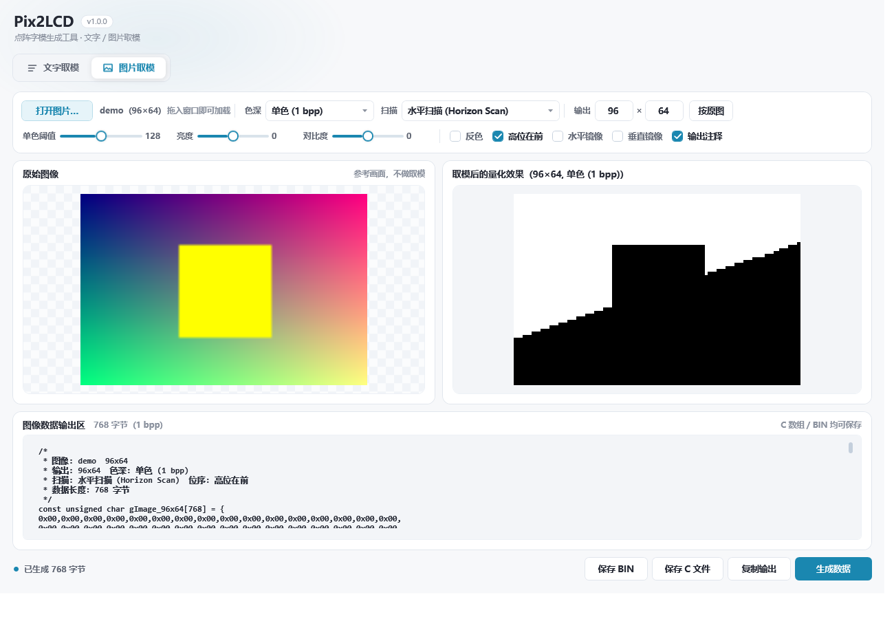

# Pix2LCD

一个用 WPF / .NET 8 实现的**点阵字模生成工具**，包含文字取模与图片取模两条完整流程：

- **文字取模**：字体渲染 → 点阵 → 四种取模方式 → 自定义输出格式 → 批量字库
- **图片取模**：图片 → 缩放/色调调整 → 色深量化 → 四种扫描方式 → C 数组 / BIN

取模规则四种扫描方式、字节内位序、阴码/阳码与补位、输出格式字段、字库索引，
实现集中在 `Core/`，全部可单测；`pix2lcd.exe --selftest` 会把结果写成报告。





---

## 构建与运行

```powershell
dotnet build
dotnet run
```

要求 .NET 8 SDK 与 Windows（WPF + GDI 字体光栅化）。

自检（不需要手动操作界面）：

```powershell
bin\Debug\net8.0-windows\pix2lcd.exe --selftest selftest.txt
```

自检覆盖：4 种取模方式的手工验算断言、取模/还原回环、GDI 字体光栅化、图片编码（含非 8 倍数宽度的字节对齐）、
输出格式、字库生成与索引。示例报告见 [assets/selftest.txt](assets/selftest.txt)。

界面截图也可以用命令行生成（无需人工操作）：

```powershell
bin\Debug\net8.0-windows\pix2lcd.exe --screenshot .\shots
```

---

## 文字取模

### 基本流程

1. 选择字体、字宽、字高（勾选「等比」时字宽自动跟随字高）。
2. 输入文字，左侧实时预览点阵与「取模走线」。
3. 选择取模方式 / 取模走向 / 点阵格式 / 输出格式，点「生成字模」。

### 四种取模方式

| 方式 | 取模顺序 | 典型用途 |
| --- | --- | --- |
| 逐列式 | 第 1 列自上而下取 8 点成 1 字节，再第 2 列…… | 常见“纵向取模”OLED/LCD |
| 逐行式 | 第 1 行自左向右取 8 点成 1 字节，再第 2 行…… | 常见“横向取模” |
| 列行式 | 先取所有列的「第 0~7 行」带，再取第 8~15 行带 | 列扫描、按 8 行分带的驱动 |
| 行列式 | 先取所有行的「第 0~7 列」带，再取第 8~15 列带 | 行扫描、按 8 列分带的驱动 |

不足 8 点自动补满：**阴码补 0、阳码补 1**。

### 取模走向

- **逆向（低位在前）**：第一个点放在 `bit0`
- **顺向（高位在前）**：第一个点放在 `bit7`

### 点阵格式

- **阴码**：亮点 = 1
- **阳码**：亮点 = 0（即阴码逐位取反）

### 输出格式

「格式」提供 C51 / A51 / 十六进制 / 二进制四种预设，并可直接改「数据前缀 / 数据后缀 / 每行个数」。
勾选「输出注释」会带上文字、字体与点阵尺寸；勾选「输出索引」会附带字符偏移。

### 变换与调整

- `B` / `I` / `U`：加粗 / 倾斜 / 下划线（走 GDI 字体样式）
- `⟲` `⟳`：旋转 90°；`⇋` `⇅`：翻转
- `去空白`：裁掉四周空白；`复位`：按字体重新渲染
- 「锁定」+「点阵」宽高：把结果放进固定尺寸画布（居中），用于对齐 8/16/24 点阵

### 生成字库

「生成字库」按钮会按当前字体与取模设置批量生成：

- **文本字模**：每个字符一个 `const unsigned char ch_xxxx[] = {...};`
- **二进制字库**：定长记录顺序拼接，可直接用「字符编码 × 每字字节数」算偏移
- 同时生成索引文件（`<字符> ~(<字节偏移>)`）

---

## 图片取模

1. 「打开图片…」或直接把图片拖进窗口。
2. 设置「输出」宽高（`按原图` 一键还原）。
3. 选色深、扫描方式，按需调阈值 / 亮度 / 对比度 / 反色 / 镜像。
4. 「生成数据」，可保存 `.c` 或 `.bin`。

### 色深

单色(1bpp)、4 色(2bpp)、16 色(4bpp)、256 色(8bpp)、RGB332、4096 色(12bpp)、
RGB565(16bpp)、RGB666(18bpp)、RGB888(24bpp)、ARGB8888(32bpp)。

### 扫描方式

| 选项 | 含义 |
| --- | --- |
| 水平扫描 (Horizon Scan) | 行主序，字节内沿 X |
| 垂直扫描 (Vertical Scan) | 列主序，字节内沿 Y |
| 行列式 (Data hor, Byte ver) | 字节内沿 X，字节顺序按列块 |
| 列行式 (Data ver, Byte hor) | 字节内沿 Y，字节顺序按行块 |

「高位在前」控制字节内位序（单色/4 色/16 色）与多字节像素的字节序。

---

## 目录结构

```
pix2lcd/
├─ Core/
│  ├─ BitMatrix.cs          二值点阵 + 旋转/翻转/裁切/缩放/回环还原
│  ├─ DotMatrixEncoder.cs   四种取模方式 + 位序 + 阴阳码
│  ├─ GdiFontRasterizer.cs  GDI 字体光栅化（CreateFontW + CreateDIBSection）
│  ├─ RgbaImage.cs          32 位图像容器 + 缩放/亮度对比度/反转/镜像
│  ├─ ImageEncoder.cs       色深量化 + 扫描顺序 + 字节打包 + 量化预览
│  ├─ OutputFormatter.cs    段/注解/数据/行 前后缀格式
│  ├─ FontLibrary.cs        批量字库（文本/二进制）+ 索引文件
│  ├─ BitmapRenderer.cs     点阵预览与取模走线着色
│  ├─ OutputEncoding.cs     输出编码（GBK 优先，回退 UTF-8）
│  └─ SelfTest.cs           内置自检
├─ Views/
│  ├─ TextModule.xaml(.cs)  文字取模面板
│  ├─ ImageModule.xaml(.cs) 图片取模面板
│  └─ LibraryDialog.cs      批量字库生成
└─ assets/
   ├─ screenshots/          界面截图
   └─ selftest.txt          自检报告样例
```

---

## 功能范围

- 不提供仿真预览功能。
- 字体光栅化只用 GDI，不做 DirectWrite/亚像素；因此不同 Windows 版本的字体粗细可能略有差异。

## 许可

[Apache License 2.0](LICENSE)
